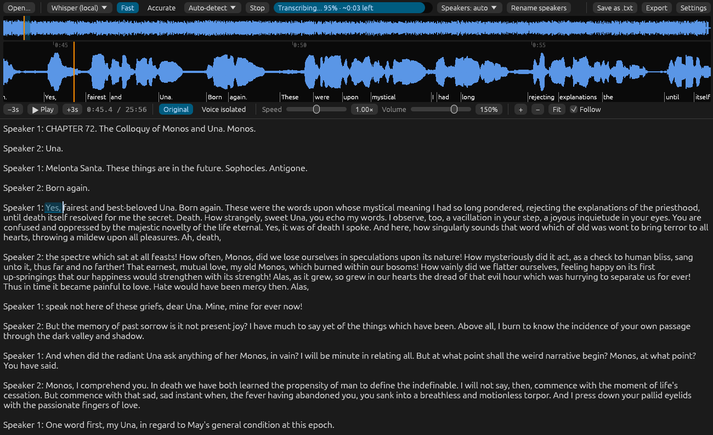

# LattR
###### Local Audio to Text: Radical

LattR is a desktop audio to text transcription software with support for editing and text based seeking.  
All words are timestamped and can be labelled by speaker.  
The focus is entirely Local private operation but Cloud apis are supported too.  



## Features:
- Support for: Windows and Linux  
- playback speed setting  
- volume boost  
- Noise reduced audio version  
- Multiple Transcription Engines

## Engines:
- Whisper (general best)  
- Omnilingual ASR (great for rare languages)  
- OpenAI or Google compatible APIs

Local inference also supports choosing between 'Fast' and 'Accurate' modes.

## Keyboard shortcuts:
- Esc / Space : Play / Pause  
- F1 / F2 : Seek  
- F3 / F4 : Speed  
- Crtl \+ o : open file  
- Crtl \+ s : save file

## Running:
### !!! FFMEPG is required, but not bundled.
you must install it manually and make it available in the path or place it next to the LattR executable.

Download the latest release that's appropriate for your system and run it.

Using the program also requires downloading models that are not bundled, but the program provides a simple interface to download them with.

## Building:
Requirements: Rust, CMake, a C/C++ compiler, libclang (for bindgen), and the Vulkan headers \+ `glslc`

Example for Debian/Ubuntu:  
`apt install cmake clang libclang-dev libvulkan-dev glslc libasound2-dev ffmpeg`

```sh  
cargo build --release                        # Vulkan GPU \+ CPU  
cargo build --release --no-default-features  # CPU only (no Vulkan SDK)  
```

### Note:
I primarily made this to learn more about rust cause i was curious, but it turned out to be useful, hence i am publishing it under GPL.  
Do not expect me to be super active with fixes, this is first and foremost a learning project. But still, Bug reports and PRs are welcome.
